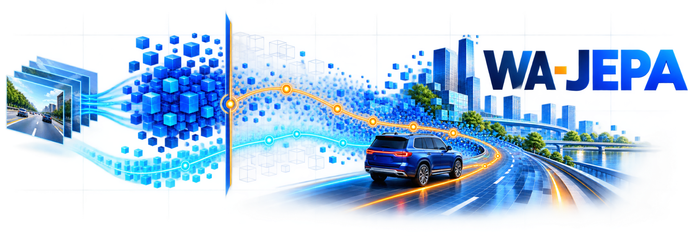
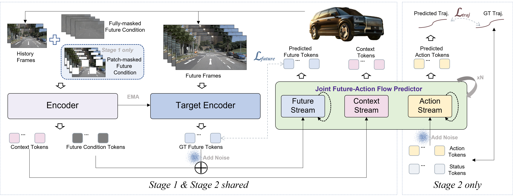
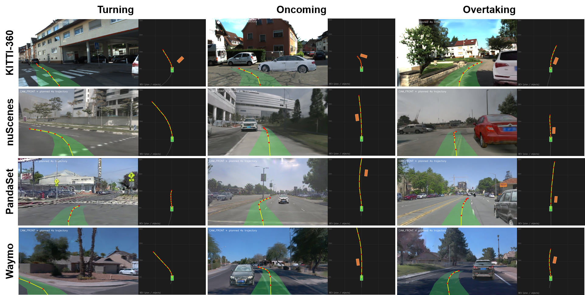
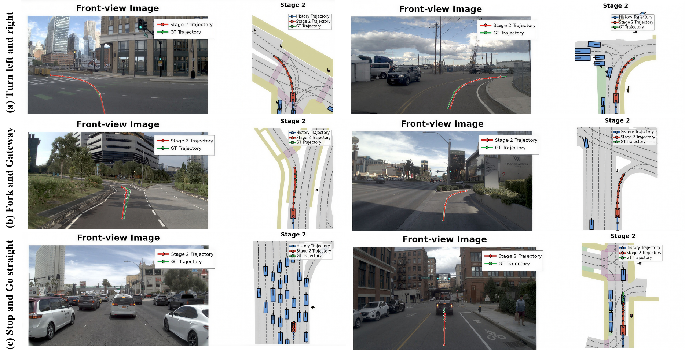

<div align="center">



<h1>WA-JEPA：重思面向自动驾驶世界-动作建模的 V-JEPA 范式</h1>

<strong>Xinlin Wang<sup>1*</sup>, Yujiao Xiang<sup>1,2*</sup>, Yuheng Zhou<sup>1,3*</sup>, Jingqi Wang<sup>1*</sup>, Minqing Huang<sup>1*,‡</sup>, Jiajie Huang<sup>1,4</sup>, Dongxu Wei<sup>1†</sup></strong><br>
<strong>Tingguang Zhou<sup>1</sup>, Xiyang Wang<sup>1</sup>, Gong Chen<sup>1,5</sup>, Zhi Xu<sup>1</sup>, Feiyang Tan<sup>1</sup>, Hangning Zhou<sup>1</sup>, Mu Yang<sup>1</sup></strong>

<sup>1</sup> [Afari Intelligent Drive](https://afari.com/) &nbsp;&nbsp;
<sup>2</sup> [电子科技大学](https://en.uestc.edu.cn/) &nbsp;&nbsp;
<sup>3</sup> [东南大学](https://www.seu.edu.cn/english/) <br>
<sup>4</sup> [北京邮电大学](https://english.bupt.edu.cn/) &nbsp;&nbsp;
<sup>5</sup> [天津大学](https://en.tju.edu.cn/)

*共同贡献，排名不分先后。† 项目负责人。‡ 通讯作者：[mqhuang1211@gmail.com](mailto:mqhuang1211@gmail.com)。*

<a href="README.md">English</a> | <a href="README.zh-CN.md"><b>中文</b></a>

[](https://wa-jepa.github.io/)
[](https://arxiv.org/abs/2608.20974)
[](https://huggingface.co/AFARI-Research/WA-JEPA)
[](#结果)
[](#结果)

</div>

## 新闻

- `[2026/08]` WA-JEPA 代码、模型权重、NAVSIM 开环评估和 HUGSIM 闭环评估已公开。
- `[2026/08]` 论文已发布于 [arXiv](https://arxiv.org/abs/2608.20974)。
- `[2026/08]` 发布的 checkpoint 在 NAVSIM v2 上达到 **91.7 EPDMS**。
- `[2026/08]` 在 HUGSIM 零样本闭环设置下取得 **0.4462 HD-Score**。

## 项目简介

WA-JEPA 是一个面向自动驾驶的 V-JEPA 原生 world-action 模型。我们通过三项设计
将 V-JEPA 2.1 从随机掩码补全扩展到面向未来的规划：

- **混合未来掩码因果预训练**：根据历史帧预测未来场景特征。
- **扩散式世界建模**：在潜空间生成合理的未来表征，而不是进行确定性回归。
- **联合世界-动作建模**：在统一的时空潜空间中同时去噪未来场景 token 与 ego 轨迹。

模型使用四路相机和四帧历史观测，在 2 Hz 下预测八个未来轨迹点，核心视觉编码器为
V-JEPA 2.1 ViT-L/16。

<div align="center">
  <a href="docs/figures/framework_overview.png">
    
  </a>
  <p><strong>WA-JEPA 框架概览。</strong> 未来掩码因果预训练用于学习预测式世界表征，联合预测器同时建模未来场景 token 与 ego 轨迹。</p>
</div>

## 结果

| 基准 | 设置 | 分数 |
| --- | --- | ---: |
| NAVSIM v2.2 | navtest，EPDMS | **91.7** |
| HUGSIM | 436 场景零样本闭环，HD-Score | **0.4462** |

完整子指标、随机种子统计、难度拆分和评测注意事项请参阅
[`docs/installation.zh-CN.md`](docs/installation.zh-CN.md)。

## 可视化

<div align="center">
  <a href="docs/figures/hugsim_vis.png">
    
  </a>
  <p><strong>HUGSIM 闭环运行可视化。</strong> 规划轨迹被投影到前视图像和鸟瞰图场景中。</p>
</div>

<div align="center">
  <a href="docs/figures/traj.png">
    
  </a>
  <p><strong>轨迹预测示例。</strong> 展示不同驾驶场景下阶段二预测、历史轨迹与真实轨迹的对比。</p>
</div>

## 开始使用

- [安装、数据集、权重与环境配置](docs/installation.zh-CN.md)
- [English README](README.md)
- [HUGSIM 闭环指南](docs/hugsim_closed_loop.zh-CN.md)
- [配置说明](configs/CONFIG_GUIDE.md)

## 引用

```bibtex
@article{wang2026wajepa,
  title={WA-JEPA: Rethinking the Video JEPA Paradigm for World-Action Modeling in Autonomous Driving},
  author={Wang, Xinlin and Xiang, Yujiao and Zhou, Yuheng and Wang, Jingqi and Huang, Minqing and Huang, Jiajie and Wei, Dongxu and Zhou, Tingguang and Wang, Xiyang and Chen, Gong and Xu, Zhi and Tan, Feiyang and Zhou, Hangning and Yang, Mu},
  journal={arXiv preprint arXiv:2608.20974},
  year={2026},
  eprint={2608.20974},
  archivePrefix={arXiv},
  primaryClass={cs.CV},
  url={https://arxiv.org/abs/2608.20974}
}
```

## 许可证

本仓库采用 Apache-2.0 协议，详见 [`LICENSE`](LICENSE)。
